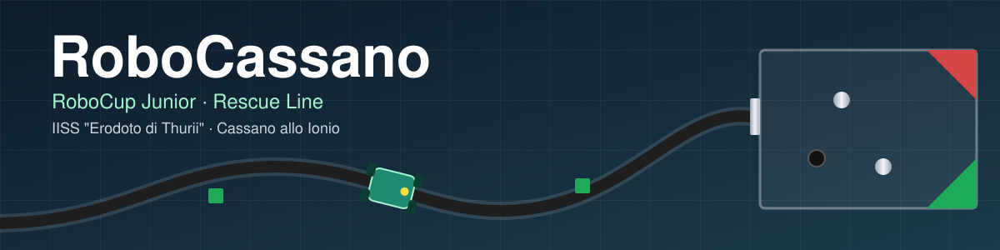
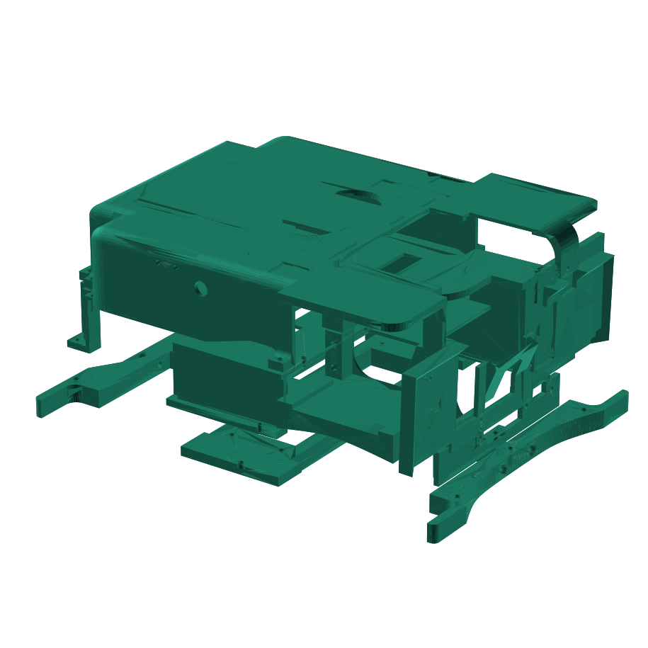
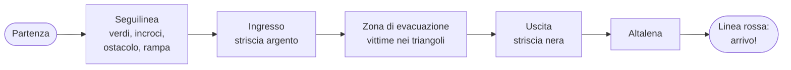
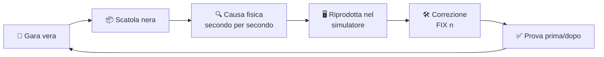

```text
  .-=================================================================================-.
  |                                                                                   |
  |      ____  ____  ____  ____  _________   __________ ___    _   ______ ___  _____  |
  |     / __ \/ __ \/ __ )/ __ \/ ____/   | / ___/ ___//   |  / | / / __ \__ \/__  /  |
  |    / /_/ / / / / __  / / / / /   / /| | \__ \\__ \/ /| | /  |/ / / / /_/ /  / /   |
  |   / _, _/ /_/ / /_/ / /_/ / /___/ ___ |___/ /__/ / ___ |/ /|  / /_/ / __/  / /    |
  |  /_/ |_|\____/_____/\____/\____/_/  |_/____/____/_/  |_/_/ |_/\____/____/ /_/     |
  |                                                                                   |
  |        -=[  RoboCup Junior  :::  Rescue Line  :::  Cassano allo Ionio  ]=-        |
  |                                                                                   |
  |       [ ClaudeRob V41 ]     [ 106 FIX ]     [ una scatola nera alla volta ]       |
  `-=================================================================================-'
```

<p align="center">
  
</p>

<p align="center">
  
  
  
  
  
  
</p>

<p align="center">
  <b>Un robot che segue la linea, supera ostacoli, rampe e altalena, entra nella zona di evacuazione,<br>
  porta in salvo le vittime e trova l'uscita. Da solo.</b>
</p>

---

## 🤖 Il robot



| | |
|---|---|
| **Cervello** | Raspberry Pi 5 |
| **Occhi** | 2 camere (linea + arena) con reti neurali **YOLO** |
| **Sensi** | Arduino Nano con 3 laser **VL53L1X**, giroscopio **BNO055**, switch |
| **Gambe** | servo a rotazione continua |
| **Mani** | pinza per le vittime (palline argento e nera) |
| **Misure** | 15,6 cm di larghezza, ~20 cm di lunghezza |
| **Memoria** | una **scatola nera** che registra tutto, 10 volte al secondo |
| **Corpo** | 5 pezzi stampati in 3D ([`Meccanica_STL/`](Meccanica_STL/)) |

<br clear="right">

## 🏁 Una gara, dall'inizio alla fine



## 🔬 Il nostro metodo: la scatola nera

Ogni gara vera lascia una **scatola nera**: laser, giroscopio, motori, quello che vede YOLO, le foto delle camere.
Ogni correzione nasce da lì, mai da un'idea a caso:



Dal primo programma della squadra a oggi: **106 correzioni** (FIX), ognuna con il suo perché, raccontate nel
[`CHANGELOG`](ClaudeRob_V41/CHANGELOG.md).

## 👥 La squadra

| | Chi | Ruolo |
|---|---|---|
| 🧑‍🏫 | **Prof. Giovanni Vaccaro** | capo squadra: decide, controlla, approva |
| 👨‍🎓 | **Battista** | seguilinea e altalena |
| 👨‍🎓 | **Gioele** | zona di evacuazione: ingresso, vittime, uscita |
| 🧠 | **Claude** | l'ingegnere del software: propone e prova le correzioni |
| 🔧 | **Shuri** | il collaudo: prova ogni versione e analizza le scatole nere ([chi è](Laboratorio%20Shuri/CHI_E_SHURI.md)) |

Lavoriamo con persone e agenti di intelligenza artificiale insieme, ma con una regola:
**il robot è nostro, e ogni modifica la deve saper spiegare chi la propone.**

## 📈 Sul campo

| Data | Versione | Com'è andata |
|---|---|---|
| 5 novembre 2026 | V36 | percorso completo, arrivo a 429 s |
| 6 novembre 2026 | V38 | percorso completo, arrivo a **376 s**, **3 vittime su 3**, altalena superata |
| 9 novembre 2026 | **V40** | percorso completo, arrivo a 388 s, **3 vittime su 3**, uscita in 64 s, altalena superata |
| prossima prova | **V41** | 🔜 ingresso senza retromarce |

Nel simulatore la V41 completa la pista della scuola con 6 semi su 6 (255-259 s) e i campi RoboCup di prova.

## 📁 Cosa c'è qui

| Cartella | Cosa c'è |
|---|---|
| [`ClaudeRob_V41/`](ClaudeRob_V41/) | il codice del robot (ultima versione). Sul Raspberry parte da solo da `~/ClaudeRob_GARA` |
| [`ClaudeRob_V40/`](ClaudeRob_V40/), [`ClaudeRob_V39/`](ClaudeRob_V39/) | le versioni precedenti, tenute per i confronti nel simulatore |
| [`ClaudeRob_Simulatore_V31/`](ClaudeRob_Simulatore_V31/) | il simulatore (Python 3 + `numpy` + `opencv-python`), con la pista della scuola |
| [`Strumenti_prove_Claude/`](Strumenti_prove_Claude/) | prove automatiche di porte e altalena nel simulatore |
| [`Laboratorio Shuri/`](Laboratorio%20Shuri/) | gli strumenti di Shuri: batteria di prove, analisi delle scatole nere, ultimo rapporto |
| [`ScatoleNere/`](ScatoleNere/) | le scatole nere delle gare vere e la foto dell'arena dall'alto |
| [`Meccanica_STL/`](Meccanica_STL/) | i pezzi stampati in 3D del robot (millimetri) |
| [`COME_LAVORARE.md`](COME_LAVORARE.md) | **per chi entra nella squadra**: GitHub, regole delle versioni, prove nel simulatore |
| [`CLAUDE.md`](CLAUDE.md) | regole del progetto, storia delle versioni e cose da fare (lo legge Claude Code) |
| `Aggiorna da GitHub.command` | doppio clic sul Mac: aggiorna la cartella `02_Robotica` con l'ultima versione |

## 🚀 Provare il robot nel simulatore

```
pip3 install numpy opencv-python
cd Strumenti_prove_Claude
python3 gira.py ../ClaudeRob_V41 prova scuola 480 seme=1
```

E per vederlo muoversi nel browser:

```
cd ../ClaudeRob_Simulatore_V31
python3 crea_replay.py prova.html replay_prova.json:"Prova V41"
```

---

<p align="center">
  <sub>Fatto a Cassano allo Ionio, una scatola nera alla volta. 🖤🟩</sub>
</p>
